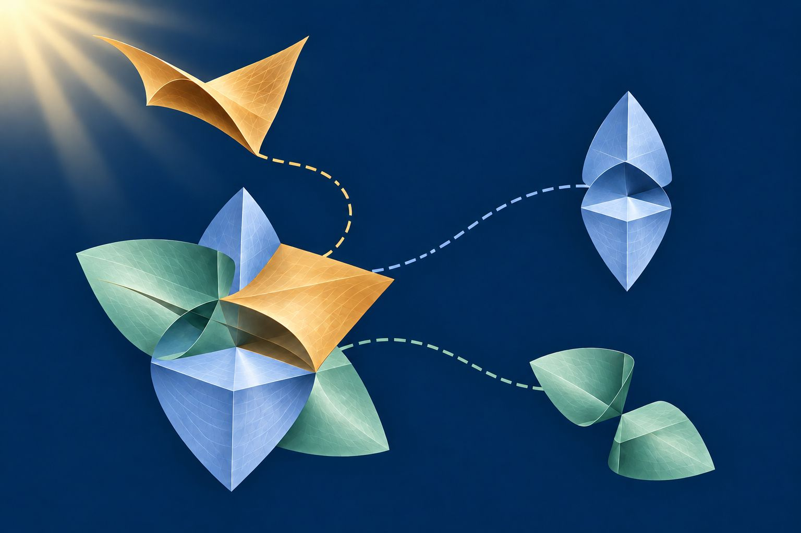
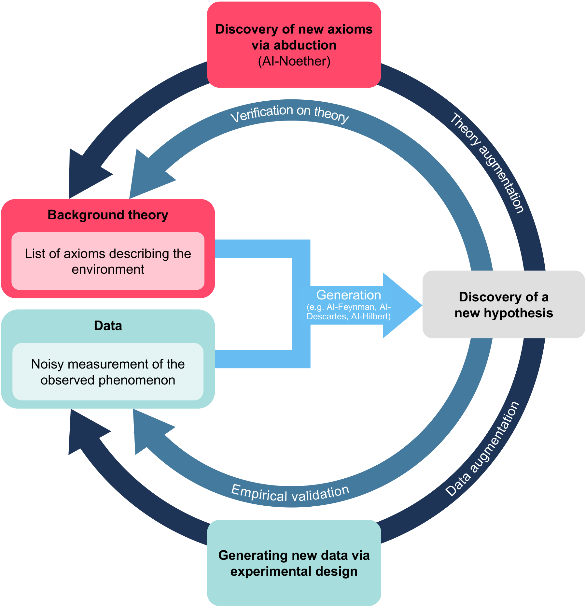
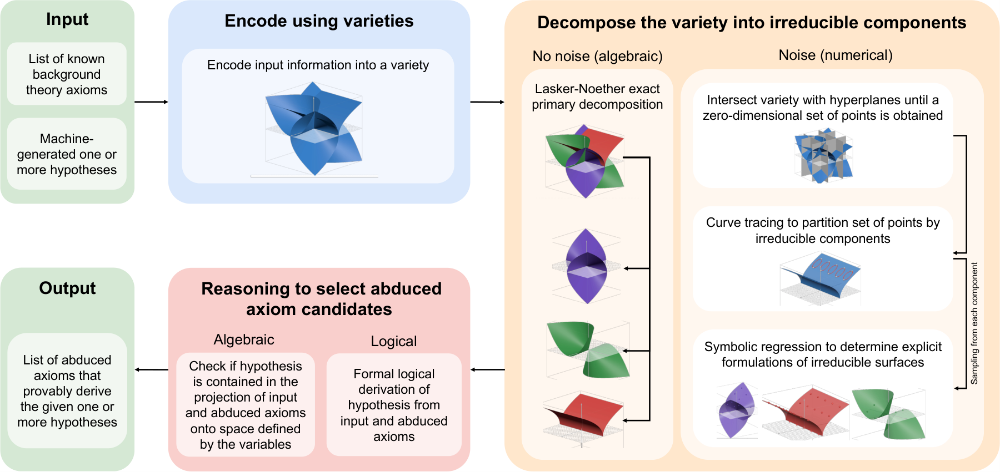
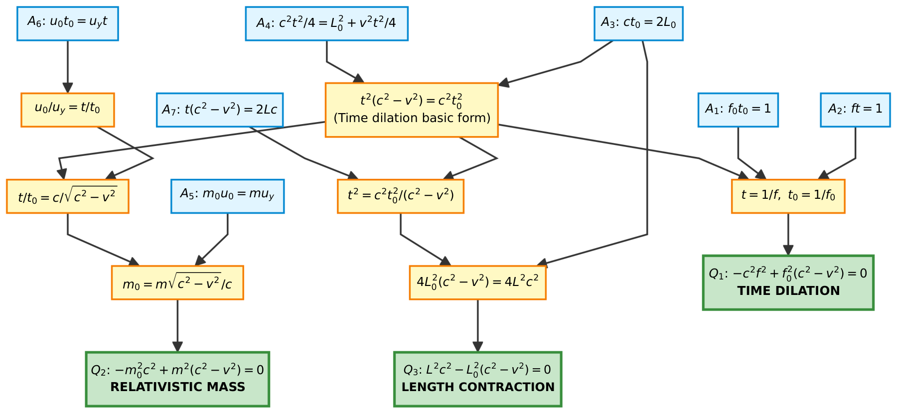
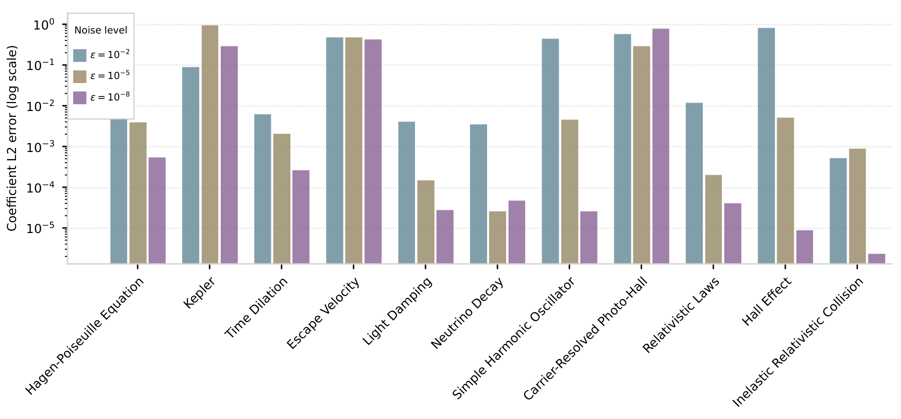

 <a href="https://ai-noether.github.io/authors"> About the authors 👤 👤 👤 </a>

 <a href="https://ai-noether.github.io/references"> References and Citation 📖 📚 </a>

 <a href="https://github.com/IBM/AI-Noether"> Code and Data   </a>

 

<em>Illustration, not computed output.</em>

> **<em>Nature Communications</em> (in press, 2026).**
> Preprints: [arXiv:2509.23004](https://arxiv.org/abs/2509.23004) and [Research Square](https://doi.org/10.21203/rs.3.rs-8424165/v1).

## AI-Noether overview

AI systems such as AI-Feynman, AI-Descartes and AI-Hilbert can now propose scientific laws from data, and the last two also check that a law is derivable from known theory. But *what if the theory is incomplete, and a law that fits the data cannot be derived from the axioms we know?*
AI-Noether addresses this **abductive step of the scientific method**. Given an incomplete set of axioms, all expressible as polynomials, and a hypothesis that those axioms cannot derive, it **generates candidate axioms that, when added to the theory, provably derive the hypothesis**, even when the hypothesis is noisy.
We show that it reconstructs key axioms needed to derive the *carrier-resolved photo-Hall effect*, *Einstein's relativistic laws*, *Kepler's third law* and several other laws.

AI-Noether complements the usual discovery loop. Data-driven methods generate a new hypothesis from data and background theory. When that hypothesis does not follow from the theory, **AI-Noether infers the axioms that are missing**, so that the theory can be augmented and the hypothesis verified against it.

### The method

AI-Noether works in three steps: **Encode**, **Decompose** and **Reason**.

**Encode.** Each known axiom $$A_1,\ldots,A_k$$ and the hypothesis $$Q$$ is a polynomial equation, so it defines a hypersurface. Their intersection is an *algebraic variety*, $$V(A_1,\ldots,A_k,Q)$$.

**Decompose.** If $$Q$$ cannot be derived from the known axioms, **the variety contains extra irreducible components that carry the missing information**. AI-Noether breaks the variety into its *irreducible components*, using exact *Lasker-Noether primary decomposition* when the hypothesis is exact, and *numerical irreducible decomposition* (homotopy continuation, witness sets and symbolic regression on the witness points) when it is noisy.

**Reason.** For each component, AI-Noether tests whether its defining polynomials, added to the known axioms, are enough to derive $$Q$$. In the exact case this is an *algebraic projection* computed with Gröbner bases; in the noisy case a *theorem prover* (KeYmaera X) checks derivability with existentially quantified constants. The candidates that pass are returned as the missing axioms.

### Recovering a missing axiom

The *carrier-resolved photo-Hall effect* relates the Hall coefficient of an illuminated semiconductor to the mobilities and concentrations of its holes and electrons.
Its derivation needs seven axioms. We remove the Hall coefficient relation, $$A_7$$, the axiom that ties all the essential quantities together, and give AI-Noether only the six remaining axioms and the photo-Hall equation.
**AI-Noether recovers $$A_7$$**, up to substitutions of the other axioms, *with no data for it and no prior knowledge of its form*.

Across twelve benchmark systems, from the Hagen-Poiseuille equation to Compton scattering, we removed each axiom in turn and tried to recover it. **AI-Noether recovered every axiom in eleven of the twelve systems**; for the combined relativistic laws, it recovered 71% and, for the rest, returned alternative axioms that still derive the laws.

### Several missing axioms

*Kepler's third law*,

$$p = \sqrt{\frac{(d_1+d_2)^3}{G(m_1+m_2)}},$$

follows from five axioms: the gravitational force, the centrifugal force, the force balance, the frequency-period relation and the center of mass. When two of them are removed at once, **AI-Noether recovers 7 of the 10 pairs**; with three removed, 2 of the 10 triples. Some are recovered as a *coupled axiom* that carries the information of several. We also give a **criterion for when a set of missing axioms can be recovered**, and AI-Noether reports an empty candidate set, rather than a spurious one, when it cannot.

### Several hypotheses at once

Einstein's *time dilation*, *relativistic mass* and *length contraction* laws share a common theory of seven axioms.

Using all three laws together, **AI-Noether recovers three missing axioms simultaneously and exactly**:

$$f t - 1, \qquad c\,t_0 - 2L_0, \qquad m_0 u_0 - m\,u_y.$$

More hypotheses add more constraints to the variety, which lets the decomposition separate axioms that a single hypothesis would only give in a coupled form.

### Noisy hypotheses

Hypotheses learned from data are noisy. We generated noisy versions of each law with AI-Hilbert, from synthetic data with Gaussian noise. For Kepler's law with 1% noise and the gravitational force axiom missing, AI-Noether returns

$$\begin{aligned}&-0.502\,F_g d_1^2 - 1.012\,F_g d_1 d_2 \\ &- 0.498\,F_g d_2^2 + 0.498\,m_1 m_2,\end{aligned}$$

**a noisy version of the missing axiom** $$F_g(d_1+d_2)^2 - m_1 m_2$$, up to scale.
The figure below shows the error of the recovered axioms across problems and noise levels.

### Comparison with the state of the art

Symbolic regression methods, including AI-Feynman and AI-Descartes, need data for the relation they fit, and *no data are available for a missing axiom*. AI-Hilbert, run in its purely deductive mode, cannot derive an axiom that does not follow from the others. Of the methods that do apply, **AI-Noether recovered the missing axiom in 97% of the single-axiom cases**, while GPT-5 Pro succeeded in none and the cvc5 SyGuS solver timed out.

### Why "Noether"

The system is named in honor of **Emmy Noether**, one of the leading mathematicians of her time. Her *primary decomposition*, the Lasker-Noether theorem that every polynomial ideal is a finite intersection of primary ideals, **is the centerpiece of AI-Noether's algorithm**: it is the Decompose step that breaks the variety of the known axioms and the hypothesis into irreducible components, and so exposes the missing axioms. The name also reflects her legacy in physics, where *Noether's theorem* on symmetries and conserved quantities uncovered the algebraic structure underlying physical laws.

### Conclusions

AI-Noether turns the abductive step of the scientific method, finding the axioms a theory is missing, into **a computational procedure with formal guarantees**. It can assess whether a new hypothesis, from data-driven or theory-based methods, can be integrated into existing theory, and under which axioms. Applied to domains where current theories are incomplete or inconsistent, abductive inference can help uncover *the principles that explain why a law should hold*.
